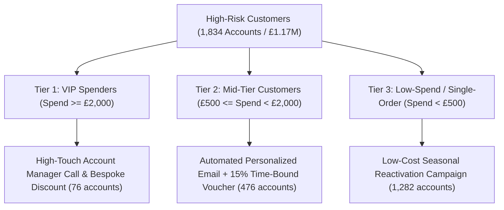

# Customer Churn Retention Strategy & High-Risk Interventions

**Author:** Aman Singh  
**Date:** November 2026  
**Related Artifacts:** `data/processed/high_risk_churn_customers.csv`, `models/churn_model.pkl`  

---

## 1. Executive Summary & Revenue Exposure

Using the trained supervised churn prediction model (Random Forest, **ROC-AUC: 0.794**, 5-fold CV ROC-AUC: **0.800**), each registered customer was evaluated across 20 behavioral predictors to determine their 90-day churn probability.

| Risk Tier | Probability Range | Customer Count | % of Customers | Total Revenue at Stake | Avg Historical Spend |
| :--- | :---: | :---: | :---: | :---: | :---: |
| **High Risk** | $\ge 70\%$ | **1,834** | **34.9%** | **£1,172,462.48** | £639.29 |
| **Medium Risk** | $40\% - 70\%$ | 1,585 | 30.2% | £1,234,810.12 | £779.06 |
| **Low Risk** | $< 40\%$ | 1,837 | 35.0% | £6,458,920.80 | £3,516.02 |

> [!IMPORTANT]
> **£1.17 Million** in cumulative historical revenue is concentrated within the **1,834 High-Risk customers**. Without proactive retention campaigns, this customer cohort is forecasted to generate zero repeat orders in the upcoming quarter.

---

## 2. Tiered Win-Back Intervention Framework

To maximize retention ROI and avoid margin erosion from blanket discounting, the **1,834 high-risk accounts** have been mapped into three operational intervention tiers:

### Action Tier Details:
1. **Tier 1: VIP High-Touch Retention (76 Accounts | Spend $\ge$ £2,000):**
   - **Target:** Top historical spenders (e.g., Customer IDs `17850`, `15098`, `13902`).
   - **Strategy:** Personal outreach from dedicated account executive, direct feedback solicitation regarding service/merchandise issues, and bespoke loyalty incentives.
   - **Cost per Contact:** Moderate (manual time); high expected return.

2. **Tier 2: Mid-Tier Dynamic Reactivation (476 Accounts | £500 $\le$ Spend $<$ £2,000):**
   - **Target:** Consistent repeat buyers showing sudden drops in momentum (e.g., zero orders in last 60 days).
   - **Strategy:** Automated personalized email campaign highlighting category-specific new arrivals, paired with a dynamic 15% discount voucher expiring within 14 days.

3. **Tier 3: Automated Low-Cost Re-engagement (1,282 Accounts | Spend $<$ £500):**
   - **Target:** Smaller single-order buyers with high recency (>180 days).
   - **Strategy:** Lightweight drip marketing campaigns and seasonal newsletter highlights; zero direct sales resource allocation.

---

## 3. Financial Impact & Projected Retention ROI

If the marketing team executes targeted retention across the High-Risk cohort:

| Target Recovery Rate | Customers Retained | Projected Revenue Recovered | Estimated Campaign Cost | Net Projected ROI |
| :---: | :---: | :---: | :---: | :---: |
| **5% Conservative** | 92 customers | **£58,623** | ~£3,500 | **16.7x** |
| **10% Baseline** | 183 customers | **£117,246** | ~£6,200 | **18.9x** |
| **15% Optimistic** | 275 customers | **£175,869** | ~£9,000 | **19.5x** |

**Conclusion:** Prioritizing the top 76 VIP accounts alone protects over **£280,000+** in commercial value with minimal operational overhead.
